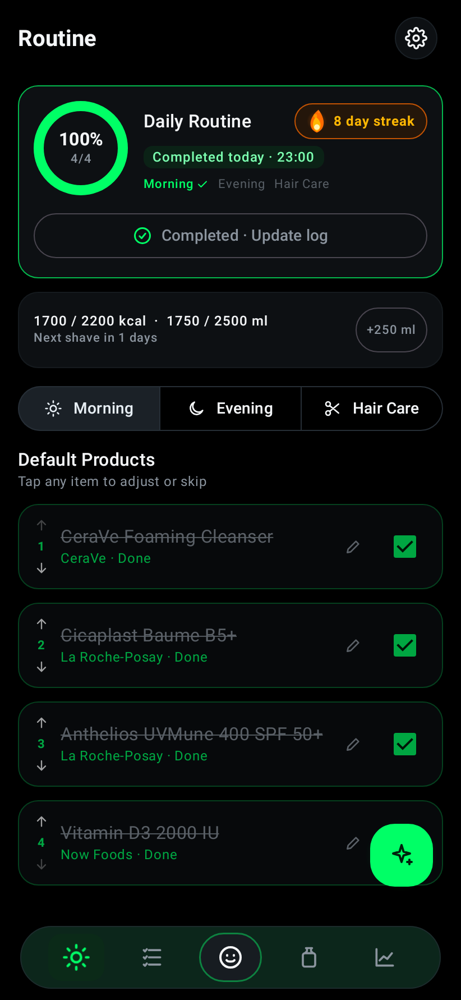
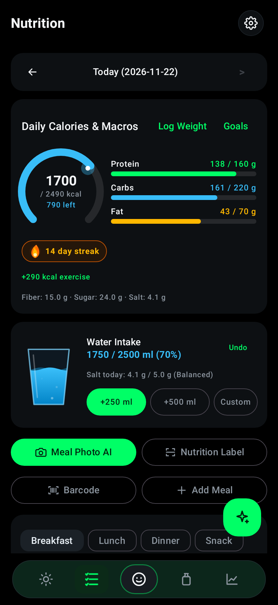
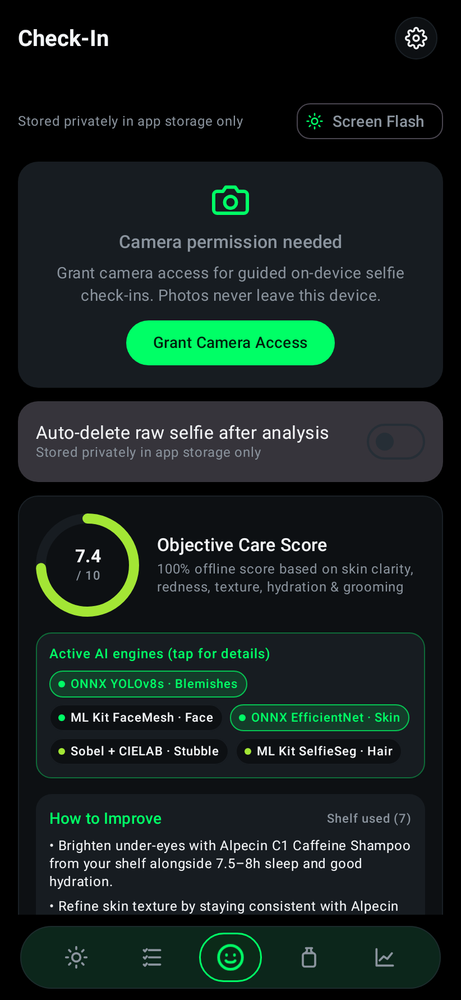
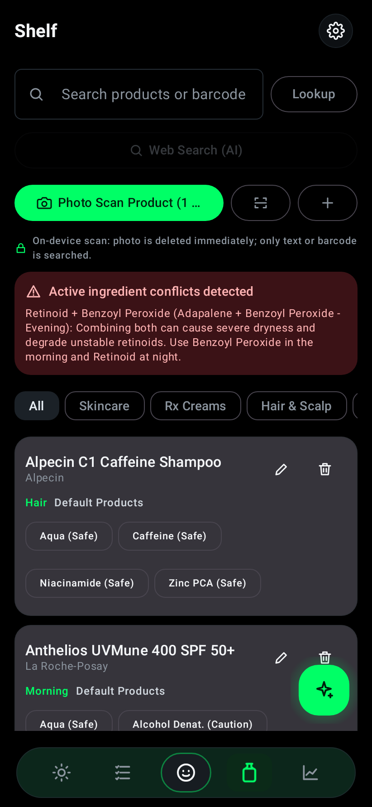
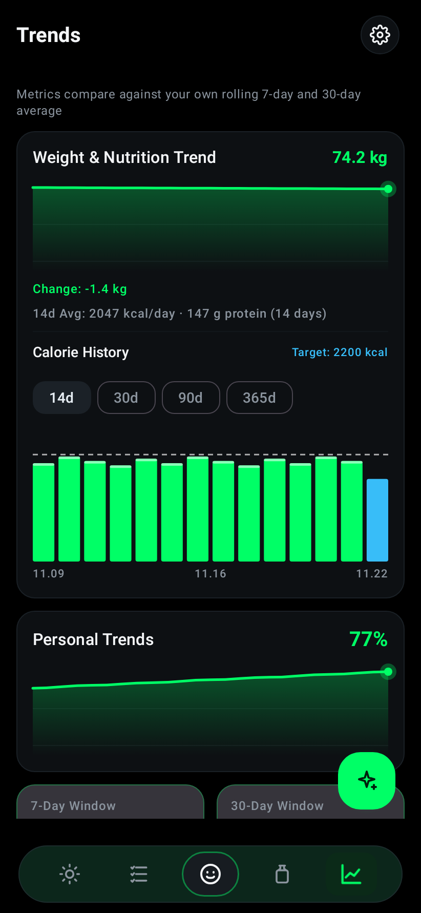

<div align="center">

# SelfCare

**Privacy-First Native Android Self-Care Hub: Smart Routine Coach, Nutrition & Hydration, Offline INCI Analyzer & Dual-ONNX On-Device Face/Hair Check-In**  
*Zero Telemetry • 100% On-Device Computer Vision • 100% In-App CameraX • Material 3 Expressive (120Hz)*

[](https://github.com/kicsirigo/SelfCare/releases/tag/v3.18.1)
[-3DDC84?style=for-the-badge&logo=android&logoColor=white)](https://developer.android.com/)
[](https://kotlinlang.org/)
[](https://developer.android.com/jetpack/compose)
[](#testing)
[](#privacy--permissions)

</div>

---

## Overview

**SelfCare** is a privacy-first native Android app built with **Kotlin**, **Jetpack Compose**, **Material 3 Expressive (120Hz)**, **Room**, **CameraX**, **bundled offline ML Kit**, and **Dual-ONNX Runtime**. It brings together daily routine coaching, nutrition & hydration tracking, an offline INCI ingredient engine, an optional AI Coach, and 100% on-device face & hair analysis — with **zero ads, zero first-party analytics, zero cloud save, and zero background data collection**. Your check-in selfies never leave your device, and every network request happens strictly on your tap.

---

## Screenshots

<div align="center">

| Today Hub & Routine | Nutrition & Water | Face & Hair Check-In | Product Shelf & INCI | Trends & AI Coach |
| :---: | :---: | :---: | :---: | :---: |
|  |  |  |  |  |

</div>

---

## Key Features

### Today Hub & Smart Routine Coach (`Routine` Tab)
- **Unified Hero Card & Live Progress Ring** — Centered `HeroScoreRing` updates live in real time whenever any product is checked or unchecked, paired with 3-period status chips (`Morning`, `Evening`, `Hair`), exact `HH:mm` completion timestamps, and an animated streak pill.
- **Today Pulse Mini-Bar** — Glanceable daily calories, 1-tap `+250 ml` hydration button, and shave countdown right from the home tab.
- **Smart Skincare Step Ordering + Custom `↑` / `↓` Reorder** — Automatically orders skincare/vitamin steps (Cleanser → Treatment → Moisturizer → SPF) and lets you customize the exact persistent order with 120Hz spring gliding (`animateItem`).
- **1-Tap Product Nickname / Rename & Live INCI Conflict Guard** — Quickly rename any product inline (pencil icon), check off clear `Done` / `To do` states, and see active ingredient conflicts before applying.
- **Custom Daily Habits (`+ Add`) & Local Reminders** — Track Teeth, Shower, Lip Balm, and custom habits with automatic midnight rollover and optional `AlarmManager` notifications.

### Calorie, Macro & Animated Water Tracker (`Nutrition` Tab)
- **3 Verified Food Databases + On-Demand Web Search (AI):**
  - **OpenFoodFacts (3M+ HU & Global)** — Fast barcode & text search with clickable verified source links (`hu.openfoodfacts.org`).
  - **USDA FoodData Central (400k+ via `DEMO_KEY` + HU→EN bridge)** — Authoritative whole-food & cooked-dish nutrition with verified `fdc.nal.usda.gov` links.
  - **250+ Offline Hungarian & International Presets + Custom Recipe Builder** — Instant 100% offline meal logging and multi-ingredient per-serving recipes.
  - **On-Demand `Web Search (AI)` (`openai/gpt-oss-20b` → `120b` with `browser_search`)** — Explicit button in Nutrition Search and Meal Confirmation (`Verify on Web (AI)`) for restaurant or newly released items.
- **In-App CameraX Meal & Label Scanner (`Groq Vision`)** — Snap plated meals (`0.5x / 1x / 1.5x` portion scaling) or back-of-package `Tápérték táblázat` nutrition labels (`qwen/qwen3.8-27b` primary + `meta-models/muse-spark-open` fallback).
- **Daily Calorie Ring, Macro Bars, Exercise (`MET`) & Weight Trend** — Tracks Calories, Protein, Carbs, Fat, Fiber, Sugar, and **Salt (g)** against customizable targets or the 100% offline **Mifflin-St Jeor** calculator, with day switching (`< Yesterday | Today >`).
- **Animated Live-Wave Water Glass with Salt Hydration Bonus** — Automatically adds `+150 ml` recommended water per excess gram of salt above the 5g WHO reference, with spring-animated wave physics.

### 100% Offline Dual-ONNX Local AI + ML Kit Face, Stubble & Hair Check-In *(Centered Dock Tab)*
- **Bundled On-Device Local AI Ensemble (100% Offline, MIT License)** — Runs two INT8-quantized ONNX models in parallel via ONNX Runtime alongside ML Kit FaceMesh & SelfieSegmentation:
  - **`OnnxAcneDetector` (`acne_detector_int8.onnx`, 11.5 MB YOLOv8s INT8):** Detects real blemish lesions (comedones, papules, pustules, nodules) with automatic CIELAB fallback.
  - **`OnnxSkinSignalsAnalyzer` (`skin_signals_int8.onnx`, 5.3 MB 4-Head EfficientNet-B0 INT8):** Predicts global structure, hydration, erythema/UV, and elasticity signals, fused with 1080px local CIELAB ROI metrics (`SkinSignalsHybridFusion`) for lighting resilience.
  - **Active AI Engine Telemetry HUD:** Shows every active on-device engine and exact analysis runtime in ms.
- **Directional Sobel Stubble Detection & Shave Reminder** — Measures lower-jaw stubble density on-device (`computeStubbleScore`), tracks days since your last shave with 1-tap **"Just Shaved"**, and alerts you at your configurable 1–14 day interval.
- **Live Face Detection, Brightness HUD, Cooldown & Screen Flash** — Real-time ML Kit FaceMesh verification, live brightness percentage readout, 5-second capture cooldown, and front screen flash.
- **Multi-Zone Face & Hair CV (`FaceMetricCalculator` + `HaircutTracker`)** — Evaluates Under-Eye Dark Circles ($\Delta E / \Delta L^*$), Surface Redness & Texture, Lip Dryness, plus **Crown Density %**, **Hair Shine %**, **Hairline Symmetry %**, and **Growth Since Haircut** with qualitative traffic-light gauges (`MetricInterpreter`).
- **Private Check-In Photo Storage** — Stored strictly inside app-private `filesDir/checkins` (with `.nomedia`), hidden from the gallery, with optional automatic deletion immediately after metrics are extracted.

### Product Shelf, Vitamins/Medications, Offline Vitamin Calculator & INCI Engine (`Shelf` Tab)
- **100% In-App CameraX Everywhere** — Live CameraX EAN/UPC barcode scanning (`OpenBeautyFacts` + `OpenFoodFacts`), optional **Groq Vision** product recognition, dedicated 100% offline **In-App CameraX INCI OCR**, on-demand **Web Search (AI)**, and **Share-to-SelfCare (`ACTION_SEND`)** text import support.
- **Bundled 69-Ingredient INCI Database** — Offline `assets/inci_database.json` covering hydrators, AHAs/BHAs/PHAs, retinoids, Vitamin C, soothing agents, peptides, prescription antibiotics (`Erythromycin`, `Clindamycin`), scalp actives (`Ketoconazole`, `Caffeine`, `Minoxidil`), and **7 localized active conflict rules**.
- **Vitamins, Supplements & Medications + Offline EFSA/NIH Calculator (`VitaminCalculator`)** — Tracks vitamins and OTC/Rx items alongside skincare, cross-referenced automatically against age-based daily reference intakes *(informational only — never replaces a balanced diet or medical advice)*.

### Personal Trends, Floating AI Coach, Expressive Motion & Live Quota Monitor
- **Personal Rolling Trends (`Trends` Tab)** — 7-day and 30-day rolling personal baselines for skin, hair, 30-day body weight, 7-day calorie/protein adherence, and routine consistency *(never medical diagnoses)*.
- **Context-Aware Floating AI Coach (`AiCoachChatSheet`)** — Accessible from any tab via the floating AI FAB; reads your local routine, shelf, nutrition, and check-in summary on demand, and strictly matches your message language (English or Hungarian).
- **Live Groq API Quota Monitor & Protected Key Vault (`Settings`)** — Tracks daily `x-ratelimit-*` headers and token usage with estimated remaining photo scans & Web Searches today, plus a locked masked API key field (`gsk_••••••••1234`) with explicit Change & Delete confirmation safeguards.
- **2026 Material 3 Expressive Motion Pack (120Hz) & AMOLED Neon UI** — Pure `#000000` AMOLED backdrop with `#00FF66` neon green accents (plus Dark & Light modes), morphing navigation pills, GPU `ExpressiveThinkingDots`, unified 24dp vector icons (`AppIcons.kt`, **zero Unicode emojis**), and **494/494** EN/HU bilingual string parity with flicker-free in-app switching.
- **Portable Local SAF JSON Backup** — 100% local export/import of all **10 Room tables** and app preferences via Android's Storage Access Framework (`kotlinx.serialization.json`).

---

## Privacy & Permissions

SelfCare is built around **local-first privacy**: **zero ads, zero first-party analytics or crash trackers, zero cloud save**, `android:allowBackup="false"`, and **zero background network calls** (even update checks only run when you tap *Check for Updates*).

### What Stays 100% On-Device
- **Check-in selfies & CV metrics** — Analyzed completely offline via bundled ML Kit + Dual-ONNX Runtime (`YOLOv8s` + `EfficientNet-B0`). Photos are saved only in app-private storage (`filesDir/checkins` with `.nomedia`) and can auto-delete immediately after analysis.
- **Database & Backups** — All 10 Room tables (routines, shelf, nutrition, water, weight, check-ins) stay strictly local. Backups use Android's local SAF JSON export/import.

### Optional, Strictly User-Initiated Network Requests
Nothing is sent unless you explicitly trigger a feature:
- **Public Food & Product Lookups (anonymous GET):** `OpenFoodFacts`, `OpenBeautyFacts`, `USDA FoodData Central`, and `Wikimedia Commons` when you search or scan a barcode.
- **GitHub Releases Update Check:** `api.github.com` only when you manually tap *Check for Updates* in Settings.
- **Optional Groq AI (`api.groq.com`, your own `gsk_...` key):** Used only when you trigger *Meal/Label/Product Photo AI* (sends that food/product photo), *Web Search (AI)* (sends your query), or *AI Coach Chat* (sends your message plus an anonymized plain-text summary of the log categories you opt into — never check-in photos, names, emails, or exact birth dates). Per Groq's Services Agreement, API inputs are **not used for model training**.
- *SDK note:* Bundled Google ML Kit runs all vision/OCR/barcode models offline without uploading images, though Google Play Services may collect anonymous internal ML Kit SDK diagnostics on devices with Play Services installed.

### Permissions
- `android.permission.CAMERA` — In-app CameraX selfie check-ins, barcode scanning, meal/label photography, and offline INCI OCR.
- `android.permission.POST_NOTIFICATIONS` — Optional local routine, shave, and haircut reminders.
- `android.permission.INTERNET` — Only for the user-initiated lookups and optional Groq API calls listed above.
- `android.permission.REQUEST_INSTALL_PACKAGES` — Only when you tap *Install Update* in the in-app release downloader.

---

## Download & Verification

Pre-built APKs are available on the [**Releases**](https://github.com/kicsirigo/SelfCare/releases/tag/v3.18.1) page *(APK size includes the bundled offline ML Kit models + ONNX Runtime with INT8 YOLOv8s & EfficientNet-B0 models for 100% offline face, blemish, skin, hair, OCR, and barcode analysis)*:

- **`SelfCare-release.apk`** (~228 MB) — Recommended. Signed, R8-minified, and resource-shrunk release build, verified with fail-closed SHA-256 in the in-app Download Manager.
- **`SelfCare-debug.apk`** (~241 MB) — Unminified debug build for testing and inspection.

### Verify APK Integrity
Download `SHA256SUMS.txt` from the release and verify locally:
```bash
sha256sum -c SHA256SUMS.txt
```

---

## Tech Stack & Architecture

- **Language & Build:** Kotlin 2.2.21, JVM 21 toolchain, Gradle Version Catalog (`gradle/libs.versions.toml`), KSP
- **UI:** Jetpack Compose + Material 3 Expressive (`ExpressiveMotion.kt`, `AppIcons.kt` 24dp vector system, zero Unicode emojis)
- **Persistence:** Room 2.8.5 (`SelfCareDatabase` v7, 10 tables), Jetpack DataStore Preferences
- **Camera & On-Device ML:** 100% In-App CameraX 1.5.3 (`Camera2Interop`), bundled ML Kit (`face-mesh-detection`, `segmentation-selfie`, `text-recognition`, `barcode-scanning`), ONNX Runtime INT8 (`YOLOv8s` + `EfficientNet-B0`)
- **Min / Target SDK:** API 26 (Android 8.0) / API 36 (Android 16)

```text
app/src/main/java/com/selfcare/app/
├── MainActivity.kt                          # Edge-to-edge host, 5-tab Expressive dock, AI Coach FAB & SAF backup
├── SelfCareApp.kt                           # Application entry point & replaceable test container
├── di/AppContainer.kt                       # Manual DI container for repos, ML/ONNX scanners, remote clients & CV
├── data/
│   ├── local/
│   │   ├── SelfCareDatabase.kt              # Room database (v7, 10 tables)
│   │   ├── SettingsRepository.kt            # DataStore preferences (theme, locale, routine order, Groq quota)
│   │   ├── SecretKeyCipher.kt               # Android Keystore AES-GCM encryption for local API key
│   │   ├── dao/                             # Routine, Product, FaceCheckIn, Hygiene, Haircut, Nutrition, Water, Recipe, Activity, Weight DAOs
│   │   └── entity/                          # 10 Room entities
│   ├── ml/                                  # MlKitFaceAnalyzer, MlKitOcrScanner, MlKitBarcodeScanner, OnnxAcneDetector, OnnxSkinSignalsAnalyzer
│   ├── preset/PresetProductCatalog.kt       # Offline Rx, skincare, hair & vitamin presets
│   ├── remote/                              # GroqVisionProductClient, OpenFoodFactsNutritionClient, UsdaFoodDataClient, OpenBeautyFactsClient, AppUpdateManager
│   └── repository/                          # Routine, Hygiene, Nutrition, Product, FaceCheckIn, Backup repositories
├── domain/
│   ├── ai/AppDataContextBuilder.kt          # Structured local summary builder for AI Coach
│   ├── cv/                                  # FaceMetricCalculator, LightingQualityChecker, HaircutTracker, MetricInterpreter, SkinSignalsHybridFusion, YoloBlemishPostProcessor
│   ├── health/                              # MacroCalculator, ActivityCalorieCalculator, FoodPresetCatalog (250+ HU/Intl), MealDatabaseGrounder, MealTimingAnalyzer, StreakCalculator, VitaminCalculator
│   ├── inci/                                # InciDatabaseLoader, InciParser, InciConflictDetector, InciEngine, SharedProductTextParser
│   └── ml/                                  # FaceAnalyzer, OcrScanner, BarcodeScanner interfaces
├── notifications/                           # NotificationHelper, ReminderReceiver, ReminderScheduler
└── ui/
    ├── components/                          # ExpressiveMotion, MetricGaugeComponents, CelebrationAnimations
    ├── icons/AppIcons.kt                    # Centralized 24dp monochrome vector icons
    ├── localization/LocaleHelper.kt         # In-app Auto / EN / HU locale helper (494/494 keys)
    ├── theme/                               # AMOLED Neon, Dark & Light Material 3 themes
    ├── routine/                             # RoutineScreen (Today Hub) & RoutineViewModel
    ├── nutrition/                           # NutritionScreen, NutritionViewModel & InAppFoodCameraDialog
    ├── checkin/                             # CheckInScreen & CheckInViewModel
    ├── shelf/                               # ShelfScreen, ShelfViewModel, ProductLiveScannerView & SmartScanQueryExtractor
    ├── trends/                              # TrendsScreen & TrendsViewModel
    ├── coach/                               # AiCoachChatSheet & AiCoachViewModel
    └── settings/                            # SettingsScreen, SettingsViewModel & PatchNotesDialog
```

---

## Building from Source

### Prerequisites
- **JDK 21**
- **Android SDK** with Build-Tools & Platform API 36

### Setup & Commands
```bash
# Clone the repository
git clone https://github.com/kicsirigo/SelfCare.git
cd SelfCare

# Configure local environment (git-ignored)
cp .env.example .env

# Compile debug Kotlin sources
./gradlew compileDebugKotlin

# Run all 103 unit & Robolectric E2E tests
./gradlew testDebugUnitTest

# Run fast unit tests only
./gradlew testDebugUnitTest --tests "com.selfcare.app.unit.*"

# Build Debug APK
./gradlew assembleDebug
```

---

## Testing

The test suite includes **103 automated tests** across **21 test suites** (`app/src/test/java/com/selfcare/app/`):
- **Unit Suites (17 suites):**
  - `RoutineRepositoryTest`, `BackupRepositoryTest` (1-tap completion, skip/reorder persistence, midnight rollover, 10-table SAF JSON roundtrip)
  - `MacroCalculatorAndNutritionTest`, `VitaminCalculatorAndProductAdviceTest` (Mifflin-St Jeor, salt hydration bonus, MET workouts, 250+ HU presets, EFSA/NIH vitamin calculator)
  - `GroqVisionProductClientTest`, `OpenBeautyFactsTest`, `InciEngineTest`, `SmartScanTest`, `SharedProductTextParserTest`, `PresetCatalogAndMetricInterpreterTest` (Groq Vision & `gpt-oss` Web Search JSON/reasoning parsing, language detection, 69-INCI conflicts, barcode & OCR extraction)
  - `FaceMetricCalculatorTest`, `LightingQualityTest`, `HaircutTrackerTest`, `FaceCheckInRepositoryTest`, `SkinSignalsHybridFusionTest`, `BlemishAndUpdateManagerTest`, `YoloBlemishAndPatchNotesTest` (CIELAB D65 math, Dual-ONNX post-processing & fusion, stubble Sobel score, fail-closed SHA-256 update verification)
- **Robolectric + Compose UI E2E Suites (4 suites, injecting deterministic ML fakes):**
  - `Tier1FeatureCoverageTest` — Core routine, nutrition, OBF + OCR + INCI, face check-in, and haircut flows
  - `Tier2BoundaryCornerTest` — Empty states, missing camera permission, poor lighting warning, offline API fallback, midnight rollover, duplicate logs, auto-delete verification
  - `Tier3PersistenceAndLocalizationTest` — Room 10-entity persistence, SAF JSON roundtrip, privacy/`.gitignore`/manifest checks, launcher icon & flicker-free locale checks, and **494/494** EN/HU parity + zero-emoji verification
  - `Tier4UserJourneyTest` — Full cross-screen skincare → routine → nutrition → check-in → personal trends journey

---

## Credits

**made by: kicsirigo**
