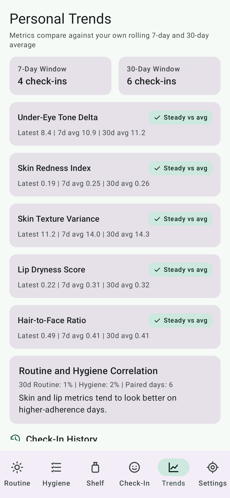

<div align="center">

# SelfCare

**Privacy-First Native Android Daily Routine, Offline INCI Analyzer & On-Device Face/Hair Check-In App**  
*Zero Telemetry • 100% On-Device Computer Vision • Bundled Offline ML Kit • Material 3*

[](https://github.com/kicsirigo/SelfCare/releases/tag/v1.0.0)
[-3DDC84?style=for-the-badge&logo=android&logoColor=white)](https://developer.android.com/)
[](https://kotlinlang.org/)
[](https://developer.android.com/jetpack/compose)
[](#testing)
[](#privacy--permissions)

</div>

---

## Overview

**SelfCare** is a privacy-first native Android application built with **Kotlin**, **Jetpack Compose**, **Material 3**, **Room**, **CameraX**, and **bundled offline ML Kit**. It brings together daily skincare routine tracking, daily hygiene logging, an offline INCI ingredient & active-conflict engine, and 100% on-device face & hair trend analysis — with **zero ads, zero analytics, and zero cloud uploads of personal photos or logs**.

---

## Screenshots

<div align="center">

| Daily Routine *(Dark)* | Product Shelf & INCI *(Dark)* | Face Check-In *(AMOLED)* | Personal Trends *(Light)* |
| :---: | :---: | :---: | :---: |
|  |  |  |  |

</div>

---

## Key Features

### Daily Routine & Hygiene Tracker
- **1-Tap Morning & Evening Routine Completion** — Configure your default Morning, Evening, or Both-slot products and log an entire routine in a single tap, with per-product skip/override toggles and duplicate-log prevention.
- **Quick Daily Hygiene Logging** — Track Shower/Bath, Morning & Evening Teeth Brushing, Lip Balm, and custom habits with automatic midnight date rollover.
- **Local Routine Reminders** — Optional on-device notifications scheduled via `AlarmManager` / `BroadcastReceiver` (gracefully handled when notification permission is not granted).
- **Portable SAF JSON Backup** — Export and import all 5 Room tables (`routine_logs`, `products`, `face_check_ins`, `hygiene_logs`, `haircut_baselines`) and app preferences via Android's Storage Access Framework (`kotlinx.serialization.json`).

### Product Shelf & Offline INCI Conflict Engine
- **Bundled 56-Ingredient INCI Database** — Offline `assets/inci_database.json` covering hydrators, AHAs/BHAs/PHAs, retinoids, Vitamin C, soothing agents, occlusives, peptides, irritants, and **6 active conflict rules** (e.g., *Retinoid + Exfoliating Acid*, *Benzoyl Peroxide + Vitamin C*, *Retinoid + Benzoyl Peroxide*).
- **Anonymous Read-Only Open Beauty Facts Lookup** — Optional barcode and product-name search using the URL configured via `.env` / `BuildConfig.OPEN_BEAUTY_FACTS_BASE_URL`, cached locally in Room with zero user/device identifiers.
- **100% Offline ML Kit Barcode & OCR Fallbacks** — Bundled `MlKitBarcodeScanner` and `MlKitOcrScanner` parse noisy label text directly on-device, alongside manual add/edit.

### 100% Offline CameraX + Bundled ML Kit Face & Hair Check-In
- **Guided CameraX Capture & Real-Time Lighting Check** — Evaluates frame luminance, clipping, and left/right illumination asymmetry (`LightingQualityChecker`) before capture and warns if lighting is `TOO_DARK`, `UNEVEN`, or `TOO_BRIGHT`.
- **Real On-Device Computer Vision Math (`FaceMetricCalculator` + `MlKitFaceAnalyzer`)**:
  - **Under-Eye Dark Circles:** sRGB-to-CIELAB conversion and $\Delta E / \Delta L^*$ delta between under-eye ROIs and cheek baselines.
  - **Skin Health:** Erythema/redness index and local spatial texture variance across cheek and forehead ROIs.
  - **Lip Dryness:** Lip ROI color uniformity and gradient/edge roughness.
  - **Hair Growth & Haircut Reminder (`HaircutTracker`):** Foreground/hair segmentation ratio relative to face height compared against an active haircut baseline, with **"Just had a haircut"** baseline reset and configurable growth reminder threshold (`5%–60%`).
- **Private Check-In Photo Storage** — Photos are saved exclusively inside app-private `filesDir/checkins` (with `.nomedia`), hidden from the device gallery, and can be automatically deleted immediately after numeric metrics are extracted.

### Personal Rolling Trends & Handcrafted UI
- **Personal Baseline Trends (Never Medical Diagnoses)** — Displays under-eye, redness, texture, lip dryness, and hair growth metrics relative to your own rolling **7-day and 30-day personal baseline**, alongside routine/hygiene adherence correlation.
- **Zero-Emoji Monochrome Iconography & 3 Themes** — Unified 24dp monochrome vector paths centralized in `AppIcons.kt` across **Light**, **Dark**, and **AMOLED Black** Material 3 themes.
- **Bilingual Localization (`EN` / `HU`)** — Full English and Hungarian string parity with in-app **Auto / English / Magyar** switching.

---

## Privacy & Permissions

SelfCare enforces strict on-device isolation with **zero analytics, crash reporting, ads, or tracking SDKs**, and `android:allowBackup="false"`:
- `android.permission.CAMERA` — Used solely for on-device CameraX guided selfie check-ins, barcode scanning, and label OCR.
- `android.permission.POST_NOTIFICATIONS` — Used solely for optional local routine and haircut reminders.
- `android.permission.INTERNET` — Permitted **only** for anonymous, read-only public lookups to Open Beauty Facts (`BuildConfig.OPEN_BEAUTY_FACTS_BASE_URL`). Face photos, check-in metrics, haircut status, product shelves, and routine logs never leave the device.

---

## Download & Verification

Pre-built APKs are available on the [**Releases**](https://github.com/kicsirigo/SelfCare/releases/tag/v1.0.0) page *(APK size includes the 4 bundled offline ML Kit models for zero-cloud face mesh, selfie segmentation, OCR, and barcode scanning)*:

- **`SelfCare-release.apk`** (~142 MB) — Recommended. R8-minified and resource-shrunk release build.
- **`SelfCare-debug.apk`** (~155 MB) — Unminified debug build for testing and inspection.

### Verify APK Integrity
Download `SHA256SUMS.txt` from the release and verify locally:
```bash
sha256sum -c SHA256SUMS.txt
```

---

## Tech Stack & Architecture

- **Language & Build:** Kotlin 2.2.21, JVM 21 toolchain, Gradle Version Catalog (`gradle/libs.versions.toml`), KSP
- **UI:** Jetpack Compose + Material 3 (Edge-to-Edge, `AppIcons` vector system)
- **Persistence:** Room 2.8.5 (`SelfCareDatabase`), Jetpack DataStore Preferences
- **Camera & On-Device ML:** CameraX 1.5.3, bundled ML Kit (`face-mesh-detection`, `segmentation-selfie`, `text-recognition`, `barcode-scanning`) behind testable domain interfaces (`FaceAnalyzer`, `OcrScanner`, `BarcodeScanner`)
- **Min / Target SDK:** API 26 (Android 8.0) / API 36 (Android 16)

```text
app/src/main/java/com/selfcare/app/
├── MainActivity.kt                          # Edge-to-edge host, SAF backup, locale & navigation
├── SelfCareApp.kt                           # Application entry point & replaceable test container
├── di/AppContainer.kt                       # Manual DI container for repos, ML scanners & CV
├── data/
│   ├── local/
│   │   ├── SelfCareDatabase.kt              # Room database (5 tables)
│   │   ├── SettingsRepository.kt            # DataStore preferences (theme, language, reminders, privacy)
│   │   ├── dao/                             # RoutineDao, ProductDao, FaceCheckInDao, HygieneDao, HaircutBaselineDao
│   │   └── entity/                          # RoutineLogEntity, ProductEntity, FaceCheckInEntity, HygieneLogEntity, HaircutBaselineEntity
│   ├── ml/                                  # MlKitFaceAnalyzer, MlKitOcrScanner, MlKitBarcodeScanner, TaskAwait
│   ├── remote/OpenBeautyFactsClient.kt      # Anonymous read-only GET client (OkHttp)
│   └── repository/                          # RoutineRepository, HygieneRepository, ProductRepository, FaceCheckInRepository, BackupRepository
├── domain/
│   ├── cv/                                  # LightingQualityChecker, FaceMetricCalculator, HaircutTracker
│   ├── inci/                                # InciDatabaseLoader, InciParser, InciConflictDetector, InciEngine
│   └── ml/                                  # FaceAnalyzer, OcrScanner, BarcodeScanner interfaces
├── notifications/                           # NotificationHelper, ReminderReceiver, ReminderScheduler
└── ui/
    ├── icons/AppIcons.kt                    # Centralized 24dp monochrome vector icons
    ├── localization/LocaleHelper.kt         # In-app Auto / EN / HU locale helper
    ├── theme/                               # Light, Dark & AMOLED Black Material 3 themes
    ├── routine/                             # RoutineScreen & RoutineViewModel
    ├── hygiene/                             # HygieneScreen & HygieneViewModel
    ├── shelf/                               # ShelfScreen & ShelfViewModel
    ├── checkin/                             # CheckInScreen & CheckInViewModel
    ├── trends/                              # TrendsScreen & TrendsViewModel
    └── settings/                            # SettingsScreen & SettingsViewModel
```

---

## Building from Source

### Prerequisites
- **JDK 21**
- **Android SDK** with Build-Tools & Platform API 36

### Setup & Commands
```bash
# Clone the repository
git clone https://github.com/kicsirigo/SelfCare.git
cd SelfCare

# Configure local environment (git-ignored)
cp .env.example .env

# Compile debug Kotlin sources
./gradlew compileDebugKotlin

# Run all 44 unit & Robolectric E2E tests
./gradlew testDebugUnitTest

# Build Debug APK
./gradlew assembleDebug
```

---

## Testing

The test suite includes **44 automated tests** across **12 test suites** (`app/src/test/java/com/selfcare/app/`):
- **Unit Suites (29 tests):**
  - `RoutineRepositoryTest` (1-tap completion, skip overrides, midnight rollover, duplicate prevention)
  - `BackupRepositoryTest` (full JSON export/import roundtrip across all 5 Room tables & settings)
  - `InciEngineTest` & `OpenBeautyFactsTest` (noisy OCR parsing, 56-ingredient matching, active conflict detection, `MockWebServer` anonymous lookups)
  - `FaceMetricCalculatorTest`, `LightingQualityTest`, `HaircutTrackerTest`, `FaceCheckInRepositoryTest` (CIELAB D65 conversion, redness/texture/lip math, lighting thresholds, baseline reset & private photo auto-delete)
- **Robolectric + Compose UI E2E Suites (15 tests, injecting deterministic `FaceAnalyzer` / `OcrScanner` / `BarcodeScanner` fakes):**
  - `Tier1FeatureCoverageTest` — Core routine, OBF + OCR + INCI, face check-in, and haircut flows
  - `Tier2BoundaryCornerTest` — Empty states, missing camera permission, poor lighting warning, offline API fallback, midnight rollover, duplicate logs, auto-delete verification
  - `Tier3PersistenceAndLocalizationTest` — Room 5-entity persistence, SAF JSON roundtrip, privacy/`.gitignore`/manifest checks, and EN/HU 153-key parity + zero-emoji verification
  - `Tier4UserJourneyTest` — Full cross-screen skincare -> routine -> hygiene -> check-in -> personal trends journey

---

## Credits

**made by: kicsirigo**
