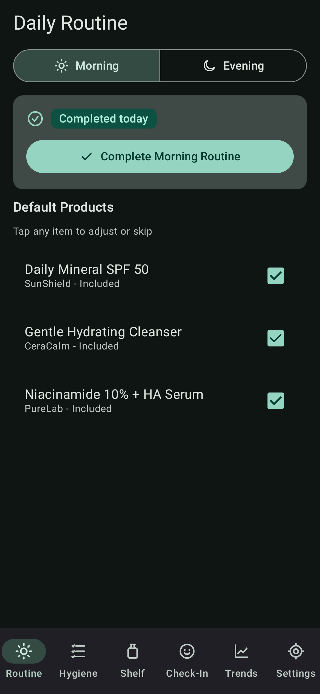
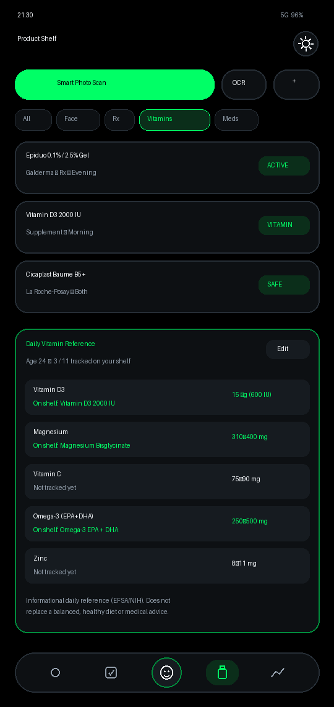
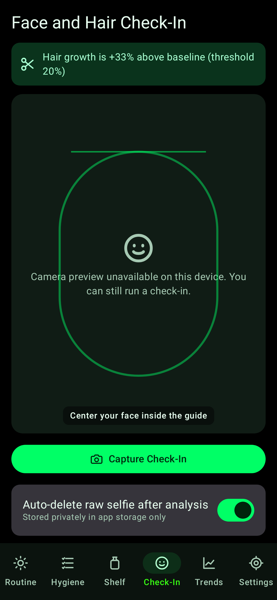

<div align="center">

# SelfCare

**Privacy-First Native Android Daily Routine, Offline INCI Analyzer & On-Device Face/Hair Check-In App**  
*Zero Telemetry • 100% On-Device Computer Vision • Bundled Offline ML Kit • Material 3*

[](https://github.com/kicsirigo/SelfCare/releases/tag/v3.18.1)
[-3DDC84?style=for-the-badge&logo=android&logoColor=white)](https://developer.android.com/)
[](https://kotlinlang.org/)
[](https://developer.android.com/jetpack/compose)
[](#testing)
[](#privacy--permissions)

</div>

---

## Overview

**SelfCare** is a privacy-first native Android application built with **Kotlin**, **Jetpack Compose**, **Material 3**, **Room**, **CameraX**, and **bundled offline ML Kit**. It brings together daily skincare routine tracking, daily hygiene logging, an offline INCI ingredient & active-conflict engine, and 100% on-device face & hair trend analysis — with **zero ads, zero analytics, and zero cloud uploads of personal photos or logs**.

---

## Screenshots

<div align="center">

| Daily Routine *(AMOLED Neon)* | Shelf & Rx/Hair *(AMOLED Neon)* | Face & Hair Scan *(AMOLED Neon)* | Personal Trends *(AMOLED Neon)* |
| :---: | :---: | :---: | :---: |
|  |  |  |  |

</div>

---

## Key Features

### Calorie, Macro & Animated Water Tracker (`Nutrition` Tab) + Celebrations
- **Day Switcher (`< Yesterday | Today >`)** — Browse, log, and edit meals, water intake, and workouts for previous days.
- **Daily Calorie Ring, Macro Bars & Offline Body Profile** — Tracks Calories (kcal), Protein, Carbs, Fat, Fiber, Sugar, and **Salt (g)** against customizable targets or the built-in 100% offline **Mifflin-St Jeor** auto-calculator (automatically reuses your saved birthday/age).
- **5 Fast Meal Logging Paths:**
  - **Meal Photo AI (`Groq Qwen 3.8 27B`):** Snap a photo of a plated meal to estimate calories, macros, and salt with `0.5x / 1x / 1.5x` portion adjustment.
  - **Nutrition Label Photo Scanner (`Groq Qwen 3.8 27B`):** Scan back-of-package `Tápérték táblázat` (per-100g values) with live gram scaling.
  - **Groq AI Text Meal Estimation:** Type any Hungarian or English dish (e.g., *csirkepörkölt nokedlivel*, *whopper*) for instant macro & salt estimation.
  - **OpenFoodFacts Barcode Scanner & Hungarian Search:** Instant per-100g nutrition lookup for packaged foods.
  - **65+ Offline Hungarian & International Presets + Custom Recipe Builder:** Combine multiple ingredients, divide by servings, and log 1 serving with 1 tap (100% offline).
- **Exercise & Burned Calories (`MET` Calculator) + Weight Trend:** Log workouts to automatically expand your daily calorie budget, and log body weight to track your 30-day Weight & 7-day Calorie/Protein Trend chart on the `Trends` tab.
- **Animated Live-Wave Water Glass with Salt Hydration Bonus:** Automatically adds `+150 ml` recommended water per excess gram of salt above the 5g WHO reference, with spring-animated wave physics and twinkling stars.
- **Zero AI Training Privacy:** Images & text sent to Groq API are never used for AI model training.

### Daily Routine Tracker
- **1-Tap Morning, Evening & Hair Care Routine Completion** — Configure your default Morning, Evening, Both, or Hair Care products and log an entire routine in a single tap, with per-product skip/override toggles and duplicate-log prevention.
- **Quick Daily Hygiene Logging** — Track Shower/Bath, Morning & Evening Teeth Brushing, Lip Balm, and custom habits with automatic midnight date rollover.
- **Local Routine Reminders** — Optional on-device notifications scheduled via `AlarmManager` / `BroadcastReceiver` (gracefully handled when notification permission is not granted).
- **Portable SAF JSON Backup** — Export and import all 5 Room tables (`routine_logs`, `products`, `face_check_ins`, `hygiene_logs`, `haircut_baselines`) and app preferences via Android's Storage Access Framework (`kotlinx.serialization.json`).

### Product Shelf, Vitamins/Medications, Offline Vitamin Calculator & INCI Engine
- **Bundled 69-Ingredient INCI Database** — Offline `assets/inci_database.json` covering hydrators, AHAs/BHAs/PHAs, retinoids, Vitamin C, soothing agents, occlusives, peptides, prescription antibiotics (`Erythromycin`, `Clindamycin`), scalp actives (`Ketoconazole`, `Caffeine`, `Minoxidil`, `Selenium Sulfide`), and **7 active conflict rules** (including *Prescription Antibiotic + Strong Acid/Retinoid*).
- **Vitamins, Supplements & Medications Support** — Track vitamins (`Vitamin D3`, `Vitamin C`, `Magnesium`, `Omega-3`, `Zinc`, `B-Complex`, `Multivitamin`) and OTC medications/ointments (`Sudocrem`, `Bepanthen Plus`, `Ibuprofen`, `Cetirizine`) alongside skincare, Rx, and hair products, with dedicated filter chips and presets.
- **100% Offline Age-Based Daily Vitamin Reference Calculator (`VitaminCalculator`)** — Enter your birthday locally (stored strictly on-device) to calculate EFSA/NIH daily vitamin & mineral reference intakes by age, cross-referenced automatically against supplements on your Shelf *(informational only — never replaces a balanced diet or medical advice)*.
- **Live Barcode Scanner + Groq Vision (`Qwen 3.8 27B`) + Offline INCI OCR + Google Lens Share** — Instant live CameraX EAN/UPC barcode scanning backed by `OpenBeautyFacts` + `OpenFoodFacts`, optional **Groq Vision** (`qwen/qwen3.8-27b` primary + `meta-models/muse-spark-open` fallback with live `/openai/v1/models` discovery, free `gsk_...` key), dedicated 100% offline **INCI OCR** for back-of-bottle ingredient lists, and **Share-to-SelfCare (`ACTION_SEND`) / Google Lens** support. Shows up to **3 multi-source reference photos** (`OpenBeautyFacts` + `OpenFoodFacts` + `Wikimedia Commons`) and privately saves your captured product photo on-device (`filesDir/products/` with `.nomedia`).
- **Full EN/HU Localized Active Conflict Alerts & Delete Safeguards** — All 7 INCI conflict warnings, routine slots, and caution badges render in English or Hungarian, and every delete action requires confirmation.

### 100% Offline Dual-ONNX Local AI (`YOLOv8s` + `EfficientNet-B0`) + CameraX (`Camera2Interop`) + ML Kit Face, Stubble & Hair Check-In *(Centered Dock Tab)*
- **Bundled On-Device Local AI Ensemble (100% Offline, MIT License)** — Runs two INT8-quantized ONNX models in parallel via ONNX Runtime alongside ML Kit FaceMesh & SelfieSegmentation:
  - **`OnnxAcneDetector` (`acne_detector_int8.onnx`, 11.5 MB YOLOv8s INT8):** Detects real blemish lesions (comedones, papules, pustules, nodules) with automatic CIELAB fallback.
  - **`OnnxSkinSignalsAnalyzer` (`skin_signals_int8.onnx`, 5.3 MB 4-Head EfficientNet-B0 INT8):** Predicts global structure, hydration, erythema/UV, and elasticity signals, fused with 1080px local CIELAB ROI metrics (`SkinSignalsHybridFusion`) for lighting resilience.
  - **Active AI Engine Telemetry UI:** Live camera HUD pill and tappable breakdown strip showing every active on-device engine and exact analysis runtime in ms.
- **Directional Sobel Stubble Detection & Shave Reminder** — Measures lower-jaw stubble density on-device (`computeStubbleScore` with directional Sobel bristle edge-density + jaw-shadow compensation), tracks days since your last shave with one-tap **"Just Shaved"**, and alerts you when your configurable 1–14 day shave interval or stubble threshold is reached.
- **Live Face Detection, Brightness HUD, Cooldown & Screen Flash** — Real-time on-device ML Kit FaceMesh checks confirm an actual face is present before turning the framing guide neon green (rejecting covered lenses or empty frames), alongside a live brightness percentage readout, 5-second capture cooldown, and Snapchat-style front screen flash.
- **Real On-Device Computer Vision Math (`FaceMetricCalculator` + `MlKitFaceAnalyzer`)**:
  - **Under-Eye Dark Circles:** sRGB-to-CIELAB conversion and $\Delta E / \Delta L^*$ delta between under-eye ROIs and cheek baselines.
  - **Skin Health:** Erythema/redness index and local spatial texture variance across cheek and forehead ROIs.
  - **Lip Dryness:** Lip ROI color uniformity and gradient/edge roughness.
  - **Multi-Zone Hair & Scalp Health (`HairDetailedMetrics` + `HaircutTracker`):** Evaluates **Crown Volume & Density %**, **Hair Shine & Smoothness %**, **Hairline & Temple Symmetry %**, plus **Growth Since Haircut** with **"Just had a haircut"** baseline reset.
- **Human-Readable Qualitative Gauges (`MetricInterpreter`)** — Translates raw scores into clear status pills (`Optimal`, `Good`, `Moderate`, `High`), animated progress bars, and everyday explanations alongside personal rolling baselines.
- **Private Check-In Photo Storage** — Photos are saved exclusively inside app-private `filesDir/checkins` (with `.nomedia`), hidden from the device gallery, and can be automatically deleted immediately after numeric metrics are extracted.

### Personal Rolling Trends, AMOLED Neon UI & Smooth Animations
- **Personal Baseline Trends (Never Medical Diagnoses)** — Displays under-eye, redness, texture, lip dryness, and multi-zone hair metrics relative to your own rolling **7-day and 30-day personal baseline**, alongside routine/hygiene adherence correlation.
- **AMOLED Pure Black + Cyber Neon Green Default Theme** — Pure `#000000` AMOLED backdrop with `#00FF66` neon green accents (plus Dark & Light modes), unified 24dp monochrome icons in `AppIcons.kt`, and 120Hz `AnimatedContent` / `animateFloatAsState` transitions.
- **Bilingual Localization (`EN` / `HU`)** — Full English and Hungarian string parity (`241/241` keys, including all INCI active conflict rules and caution badges) with flicker-free in-app **Auto / English / Magyar** switching, 5-tab bottom navigation, and a persistent top-right Settings shortcut.

---

## Privacy & Permissions

SelfCare enforces strict on-device isolation with **zero analytics, crash reporting, ads, or tracking SDKs**, and `android:allowBackup="false"`:
- `android.permission.CAMERA` — Used solely for on-device CameraX guided selfie check-ins, barcode scanning, and label OCR.
- `android.permission.POST_NOTIFICATIONS` — Used solely for optional local routine and haircut reminders.
- **Privacy & Zero AI Training:** Face check-in selfies, trends, body profile, and routine logs are 100% offline on-device. Optional product/meal photos and text sent to Groq API (`qwen/qwen3.8-27b`) are **never used for AI model training** (per Groq's official Services Agreement, including on the free tier).
- `android.permission.INTERNET` — Permitted **only** for anonymous, read-only public lookups to Open Beauty Facts / OpenFoodFacts (`BuildConfig.OPEN_BEAUTY_FACTS_BASE_URL`), GitHub Release updates, and optional user-initiated Groq Vision requests. Face photos, check-in metrics, haircut status, product shelves, and routine logs never leave the device.

---

## Download & Verification

Pre-built APKs are available on the [**Releases**](https://github.com/kicsirigo/SelfCare/releases/tag/v3.4.0) page *(APK size includes the bundled offline ML Kit models + ONNX Runtime with INT8 YOLOv8s & EfficientNet-B0 models for 100% offline face, blemish, skin, hair, OCR, and barcode analysis)*:

- **`SelfCare-release.apk`** (~228 MB) — Recommended. R8-minified and resource-shrunk release build, verified with fail-closed SHA-256 in the in-app Download Manager.
- **`SelfCare-debug.apk`** (~241 MB) — Unminified debug build for testing and inspection.

### Verify APK Integrity
Download `SHA256SUMS.txt` from the release and verify locally:
```bash
sha256sum -c SHA256SUMS.txt
```

---

## Tech Stack & Architecture

- **Language & Build:** Kotlin 2.2.21, JVM 21 toolchain, Gradle Version Catalog (`gradle/libs.versions.toml`), KSP
- **UI:** Jetpack Compose + Material 3 (Edge-to-Edge, `AppIcons` vector system)
- **Persistence:** Room 2.8.5 (`SelfCareDatabase`), Jetpack DataStore Preferences
- **Camera & On-Device ML:** CameraX 1.5.3, bundled ML Kit (`face-mesh-detection`, `segmentation-selfie`, `text-recognition`, `barcode-scanning`) behind testable domain interfaces (`FaceAnalyzer`, `OcrScanner`, `BarcodeScanner`)
- **Min / Target SDK:** API 26 (Android 8.0) / API 36 (Android 16)

```text
app/src/main/java/com/selfcare/app/
├── MainActivity.kt                          # Edge-to-edge host, SAF backup, locale & navigation
├── SelfCareApp.kt                           # Application entry point & replaceable test container
├── di/AppContainer.kt                       # Manual DI container for repos, ML scanners & CV
├── data/
│   ├── local/
│   │   ├── SelfCareDatabase.kt              # Room database (5 tables)
│   │   ├── SettingsRepository.kt            # DataStore preferences (theme, language, reminders, privacy)
│   │   ├── dao/                             # RoutineDao, ProductDao, FaceCheckInDao, HygieneDao, HaircutBaselineDao
│   │   └── entity/                          # RoutineLogEntity, ProductEntity, FaceCheckInEntity, HygieneLogEntity, HaircutBaselineEntity
│   ├── ml/                                  # MlKitFaceAnalyzer, MlKitOcrScanner, MlKitBarcodeScanner, TaskAwait
│   ├── remote/OpenBeautyFactsClient.kt      # Anonymous read-only GET client (OkHttp)
│   └── repository/                          # RoutineRepository, HygieneRepository, ProductRepository, FaceCheckInRepository, BackupRepository
├── domain/
│   ├── cv/                                  # LightingQualityChecker, FaceMetricCalculator, HaircutTracker
│   ├── inci/                                # InciDatabaseLoader, InciParser, InciConflictDetector, InciEngine
│   └── ml/                                  # FaceAnalyzer, OcrScanner, BarcodeScanner interfaces
├── notifications/                           # NotificationHelper, ReminderReceiver, ReminderScheduler
└── ui/
    ├── icons/AppIcons.kt                    # Centralized 24dp monochrome vector icons
    ├── localization/LocaleHelper.kt         # In-app Auto / EN / HU locale helper
    ├── theme/                               # Light, Dark & AMOLED Black Material 3 themes
    ├── routine/                             # RoutineScreen & RoutineViewModel
    ├── hygiene/                             # HygieneScreen & HygieneViewModel
    ├── shelf/                               # ShelfScreen & ShelfViewModel
    ├── checkin/                             # CheckInScreen & CheckInViewModel
    ├── trends/                              # TrendsScreen & TrendsViewModel
    └── settings/                            # SettingsScreen & SettingsViewModel
```

---

## Building from Source

### Prerequisites
- **JDK 21**
- **Android SDK** with Build-Tools & Platform API 36

### Setup & Commands
```bash
# Clone the repository
git clone https://github.com/kicsirigo/SelfCare.git
cd SelfCare

# Configure local environment (git-ignored)
cp .env.example .env

# Compile debug Kotlin sources
./gradlew compileDebugKotlin

# Run all 58 unit & Robolectric E2E tests
./gradlew testDebugUnitTest

# Build Debug APK
./gradlew assembleDebug
```

---

## Testing

The test suite includes **58 automated tests** across **15 test suites** (`app/src/test/java/com/selfcare/app/`):
- **Unit Suites (41 tests):**
  - `RoutineRepositoryTest` (1-tap completion, skip overrides, midnight rollover, duplicate prevention)
  - `BackupRepositoryTest` (full JSON export/import roundtrip across all 5 Room tables & settings)
  - `InciEngineTest`, `OpenBeautyFactsTest`, `PresetCatalogAndMetricInterpreterTest`, `SmartScanTest` & `GeminiVisionProductClientTest` (noisy OCR parsing, 69-ingredient matching, active conflict detection, Davercin/Skinoren/Nizoral offline presets, Gemini Vision JSON parsing & normalization, 1-photo smart query extraction & temp-photo deletion, qualitative gauges & multi-zone hair analysis)
  - `FaceMetricCalculatorTest`, `LightingQualityTest`, `HaircutTrackerTest`, `FaceCheckInRepositoryTest` (CIELAB D65 conversion, redness/texture/lip/hair math, lighting thresholds, baseline reset & private photo auto-delete)
- **Robolectric + Compose UI E2E Suites (17 tests, injecting deterministic `FaceAnalyzer` / `OcrScanner` / `BarcodeScanner` fakes):**
  - `Tier1FeatureCoverageTest` — Core routine, OBF + OCR + INCI, face check-in, and haircut flows
  - `Tier2BoundaryCornerTest` — Empty states, missing camera permission, poor lighting warning, offline API fallback, midnight rollover, duplicate logs, auto-delete verification
  - `Tier3PersistenceAndLocalizationTest` — Room 5-entity persistence, SAF JSON roundtrip, privacy/`.gitignore`/manifest checks, launcher icon & flicker-free locale checks, and EN/HU 241-key parity + zero-emoji verification
  - `Tier4UserJourneyTest` — Full cross-screen skincare -> routine -> hygiene -> check-in -> personal trends journey

---

## Credits

**made by: kicsirigo**
